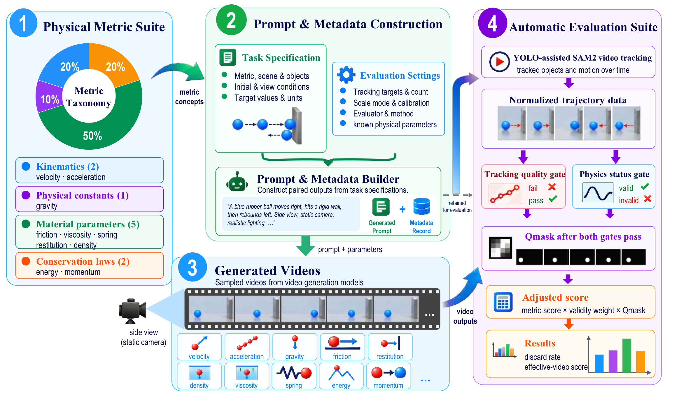

# PhysEval

**面向文生视频的定量物理评测**

[English](README.md) | [简体中文](README_zh-CN.md)

[](LICENSE)

PhysEval 用于衡量生成视频对定量物理约束的遵循程度。项目提供覆盖 **10 项物理指标的 500 组提示词与元数据**，通过自动跟踪、物理量估计和目标值比较，评测文生视频模型的物理准确性。



[基准数据](#-基准数据) · [环境配置](#-环境配置) · [快速开始](#-运行评测) · [评分说明](SCORING_USAGE.md) · [批量使用说明](BATCH_USAGE.md) · [代码架构](docs/ARCHITECTURE.md)

---

## ✨ 核心特性

- **定量目标**：每项指标包含 50 组提示词与元数据，覆盖运动学、重力、材料参数和守恒类任务。
- **自动测量**：采用固定的 YOLO 优先、运动检测回退初始化规则，结合 SAM2 跟踪与各任务的逆物理估计模型。
- **考虑测量质量**：用跟踪和物理估计有效性门控判断可测量性，再通过连续掩膜质量分调整得分。
- **结果可追溯**：保留每条视频的目标值、测量值、轨迹、评估器状态、质量证据和失败原因。
- **统一运行入口**：通过 `physeval.py` 完成评测与评分。

## 🛠️ 环境配置

使用 **Python 3.10+**，新建环境可选择 Python 3.11。基础依赖要求 **PyTorch ≥ 2.5.1**、**Torchvision ≥ 0.20.1**，与 [SAM2 的安装要求](https://github.com/facebookresearch/sam2#installation)一致。视频跟踪推荐使用支持 CUDA 的 GPU。

```bash
# 1. 克隆仓库。
git clone https://github.com/Cryptic0429/PhysEval.git
cd PhysEval

# 2. 创建环境。
conda create -n physeval python=3.11 -y
conda activate physeval

# 3. 安装基础依赖。
python -m pip install -r requirements.txt
```

在 GPU 服务器上，如有需要，请在最后一步之前安装与 CUDA 环境兼容的 `torch` 和 `torchvision`。

> 以下命令均在仓库根目录运行，即包含 `physeval.py` 的目录。

## 🤗 模型资源

准备 SAM2 源码、检查点和 YOLO 权重，并安装 SAM2：

```bash
bash tools/setup_assets.sh --install-sam2
```

默认资源路径如下：

| 资源 | 本地路径 |
| --- | --- |
| SAM2 源码 | `repo/sam2/` |
| SAM2.1 Base+ 检查点 | `repo/sam2/checkpoints/sam2.1_hiera_base_plus.pt` |
| YOLOv8n 权重 | `yolov8n.pt` |

正式评测固定先尝试 YOLO；调用失败或未提供足量的可用目标提示时，回退到运动检测。常规评测应准备 YOLO 和 SAM2 资源。其他 SAM2 模型大小或自定义资源路径见 `bash tools/setup_assets.sh --help`；评测时需传入匹配的 `--model-cfg` 和 `--model-weights`。

## 📦 基准数据

提示词与元数据已包含在 [`benchmark/metadata/`](benchmark/metadata/README_zh-CN.md) 中，无需另外下载基准数据。

| 文件 | 内容 |
| --- | --- |
| [`phys_t2v_bench_prompts.xlsx`](benchmark/metadata/phys_t2v_bench_prompts.xlsx) | `All_Prompts` 工作表中的视频生成提示词 |
| [`phys_t2v_bench_metadata.xlsx`](benchmark/metadata/phys_t2v_bench_metadata.xlsx) | `metadata` 工作表中的目标值、单位、评估器设置、物体数和尺度信息 |
| [`csv/`](benchmark/metadata/csv/) | 所有工作表的 UTF-8 CSV 导出 |

每项指标包含 **50 条样本**，合计 **500 条**：

| 类别 | 指标 | 测量依据 | 物体数 |
| --- | --- | --- | ---: |
| 运动学 | 速度 | 线性轨迹斜率 | 1 |
| 运动学 | 加速度 | 二次轨迹系数 | 1 |
| 物理常量 | 重力加速度 | 自由落体加速度 | 1 |
| 材料参数 | 摩擦系数 | 减速度与重力加速度之比 | 1 |
| 材料参数 | 恢复系数 | 碰撞后与碰撞前的速度比 | 1 |
| 材料参数 | 密度 | 流体中下落的初始加速度 | 1 |
| 材料参数 | 流体黏度 | 终端速度 | 1 |
| 材料参数 | 弹簧劲度系数 | 已知质量下的振动周期 | 1 |
| 守恒 | 机械能守恒 | 能量比 | 1 |
| 守恒 | 一维动量守恒 | 相对动量误差 | 2 |

为每条提示词生成一个视频，严格按照元数据的 `Video_File` 列命名，并将各模型的视频分别存放。下文以 `my_model` 为例：

```text
data/t2v_videos/my_model/
├── V001.mp4
├── V002.mp4
├── ...
└── P050.mp4
```

生成视频和外部模型资源需在本地准备。评测程序根据元数据中的文件名匹配视频。

## 🚀 运行评测

```text
生成视频 → YOLO 初始化 → 必要时回退运动检测 → SAM2 跟踪
         → 质量诊断和物理量估计（eval）
         → 结合测量质量评分并生成模型报告（score）
```

YOLO 只负责提供初始化提示，后续由 SAM2 传播掩膜。YOLO 报错、没有可用检测或目标数量不足时触发运动检测回退；运动检测也必须提供所需数量，否则记录初始化失败。`run_config.json` 和 `tracking_points.json` 保存固定策略、最终采用的初始化来源（`auto_yolo` 或 `auto_motion`）以及回退原因。

### 1. 先运行一个视频

评测 `V001` 并保存跟踪可视化，检查初始化和跟踪效果：

```bash
python physeval.py eval \
  --metadata benchmark/metadata/phys_t2v_bench_metadata.xlsx \
  --video-root data/t2v_videos/my_model \
  --output-dir batch_eval_results/my_model \
  --prompt-id V001 \
  --vis
```

### 2. 运行完整基准

对所有元数据行执行跟踪与物理量估计：

```bash
python physeval.py eval \
  --metadata benchmark/metadata/phys_t2v_bench_metadata.xlsx \
  --video-root data/t2v_videos/my_model \
  --output-dir batch_eval_results/my_model
```

优先查看 `batch_eval_results/my_model/<metric>/<prompt_id>/result.json`。每条样本还会保存 `tracking_points.json`、`run_config.json` 和掩膜质量诊断。

### 3. 汇总评分

完整评测结束后，按照当前实现的 PhysEval 评分规则汇总结果：

```bash
python physeval.py score \
  --result-root batch_eval_results/my_model \
  --model-name my_model
```

评分程序默认采用 0.8 的 `weak_valid` 权重并检查基准结果完整性。如仅为部分样本做流程检查，可添加 `--metadata none`。

## 📊 评分与报告

PhysEval 分别衡量**可测量性**与**物理准确性**。视频只有通过预期物体数、有效帧覆盖率和有效运动的跟踪检查，且物理评估器返回 `valid` 或 `weak_valid`，才进入有效集合。

对有效集合中的视频，PhysEval 定义评分公式为：

```text
物理准确性得分 = 100 × exp(-相对误差 / tau)
调整后得分 = 物理准确性得分
             × 跟踪质量系数
             × 掩膜质量分
             × 估计有效性系数
```

`tau` 是各指标对应的误差容忍度。通过跟踪检查的质量系数为 `1`；估计有效性系数在 `valid` 时为 `1`，在 `weak_valid` 时为 `0.8`。

**掩膜质量评分 Q_mask**使用包括归一化质心跳步在内的十项诊断，将阈值归一化的劣化程度 `p` 映射为 `1 - p^0.35`，在分量与对象间取最小值聚合。异常标记不改变已有分量分值；单项缺失分量被忽略，而有效中段帧不足等明确诊断出的失败贡献零分。评测样本必须保留有效的对象级掩膜诊断，缺失时程序报错提示重新生成而非赋予兜底分。Q_mask 作为乘数调整最终得分，不单独改变有效资格。

| 报告量 | 含义 |
| --- | --- |
| **有效视频得分** | 有效视频的调整后得分均值，应与剔除率一同报告。 |
| **剔除率** | 未通过跟踪质量、物理估计有效性或两项检查的视频比例。 |
| **端到端得分** | 以全部视频为分母、给剔除视频记零分的补充结果。 |

评分先在各指标内汇总，模型总分再对各指标等权平均。基准样本标识不完整、有效物理估计缺少可计算误差，或缺少所需对象掩膜诊断时，程序会停止正式汇总。显式使用 `--mask-policy ignore` 的消融实验会跳过掩膜评分。

报告保存于 `batch_eval_results/my_model/score_reports/all_metrics/`：

| 输出 | 内容 |
| --- | --- |
| `score_summary.json` | 模型与指标汇总、评分设置与配置信息 |
| `metric_scores.csv` | 各指标得分与可测量性统计 |
| `per_video_scores.csv` | 逐视频测量值、质量因素、状态和分数 |
| `score_exclusion_reasons.csv` | 各类剔除原因的计数 |
| `plots/` | 得分与剔除率图表 |

相对误差定义、阈值、完整性检查和敏感性分析选项见[评分说明](SCORING_USAGE.md)。

## ⚙️ 常用评测参数

| 参数 | 默认值 | 用途 |
| --- | --- | --- |
| `--metadata` | 从 `data/metadata/` 自动查找 | 评测发布基准时，应像上文一样显式传入工作簿。 |
| `--prompt-id` | 全部行 | 选择单条提示词进行流程检查。 |
| `--reuse-tracking` | 关闭 | 存在跟踪 JSON 时复用。 |
| `--eval-only` | 关闭 | 仅根据已有跟踪 JSON 估计物理量。 |
| `--vis` / `--diagnostics` | 关闭 | 保存跟踪视频 / 更多调试输出。 |
| `--sam2-precision` | `auto` | 选择 `auto`、`fp32`、`fp16` 或 `bf16` 推理。 |
| `--area-action` | `warn` | 将掩膜质量标记作为警告保留；`skip` 会改变评测策略。 |

完整参数见 `python physeval.py eval --help` 或 `python physeval.py score --help`。跟踪复用、自定义检查点和故障排查见[批量使用说明](BATCH_USAGE.md)。

## 🧱 项目结构

```text
PhysEval/
├── physeval.py                    # 公开命令行入口
├── physics_eval/
│   ├── cli.py / config.py         # 命令与统一默认值
│   ├── pipeline.py / estimation.py # 正式评测与物理估计调度
│   ├── schemas.py                # 共用提示和视频接口
│   ├── tracking/                 # 初始化和SAM2 后端
│   ├── evaluators/               # 十项物理评估器
│   ├── calibration.py / math/    # 尺度标定、拟合和几何
│   ├── quality/                  # 跟踪门控与掩膜证据/Q_mask
│   ├── io/                       # 元数据、轨迹、结果和报告读写
│   └── scoring.py / reporting.py # 评分、汇总与绘图
├── experiments/                  # 已保存证据上的研究分析
├── validation/                   # 真实视频预检和可控掩膜验证
├── tools/                        # 资源准备、环境诊断和维护
├── tests/                        # 单元、合成对照和集成检查
├── assets/                       # README 使用的论文配图
├── benchmark/metadata/           # 发布的工作簿与 CSV
├── configs/scoring/              # Q_mask 评分规则配置
├── requirements*.txt             # 核心与测试依赖
├── LICENSE                       # MIT 协议
└── docs/ARCHITECTURE.md           # 模块职责与工作流程
```

[代码架构说明](docs/ARCHITECTURE.md)描述完整工作流程与模块职责。实验与验证通过独立命令运行，`eval` 不会自动执行这些步骤。

## 🧪 研究分析、验证与维护

```bash
# 基于已有评测结果分析评分敏感性，无需重新跟踪。
python physeval.py analyze-sensitivity --results-root batch_eval_results/my_model --output-dir runs/sensitivity

# 运行可控合成掩膜检验。
python physeval.py validate-masks --output runs/validation/mask_controls.csv

# 检查真实视频验证包，可跳过 GPU 推理环境检查。
python physeval.py validate-open-video --data-only

# 按需检查评测环境、GPU 或已保存掩膜。
python tools/check_environment.py
python tools/check_gpu.py
python tools/inspect_masks.py --sam2-json path/to/tracking_points.json

# CPU 回归测试。
python -m pip install -r requirements-test.txt
python -m pytest tests
```

`analyze-sensitivity` 在已有结果上调整容忍度、有效性权重和掩膜阈值等参数，评估最终排名的敏感性。

## 🔍 适用范围与假设

当前评估器针对较短的单目视频，使用可检查的逆物理模型。测量依赖固定相机、近似平行于图像平面的运动、已知或可推断的时间基准、稳定的二维轨迹，以及需要物理单位时的尺度标定。

相机运动、深度变化、透视变化、遮挡、形变、旋转或复杂交互都可能影响估计。跟踪门控与掩膜质量能揭示部分问题，但不能证明完整的三维物理正确性。请在这些测量假设内解读得分。

## 🙏 致谢

跟踪流程基于 [SAM2](https://github.com/facebookresearch/sam2) 和 [Ultralytics YOLO](https://github.com/ultralytics/ultralytics)。

## 📄 开源协议

PhysEval 基于 [MIT 协议](LICENSE)开源。第三方模型资源遵循各自协议：SAM2 采用 Apache-2.0，Ultralytics YOLO 采用 AGPL-3.0。
