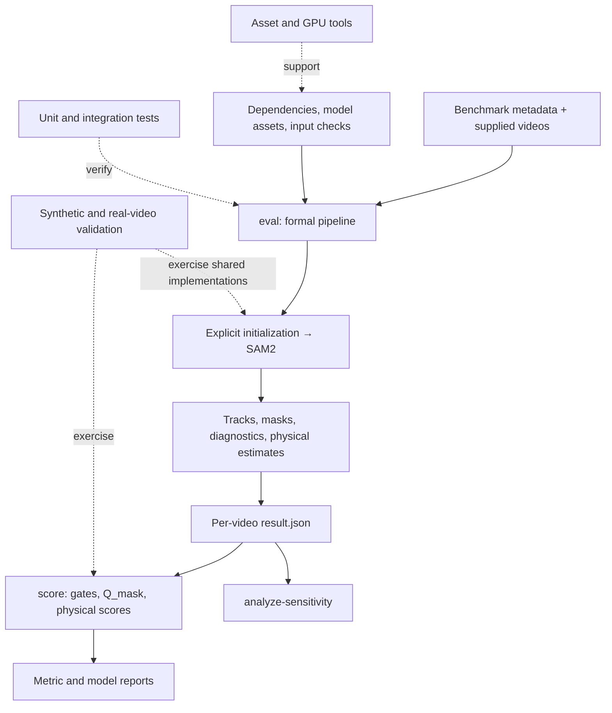

# Architecture

PhysEval separates reusable measurement code, workflow orchestration, research experiments, validation, and operational tools. The public entry point is [physeval.py](../physeval.py); it calls [physics_eval.cli](../physics_eval/cli.py) directly.

## Workflows



Video generation remains external. Validation, analysis and tests are separate workflows; eval does not automatically run them or invoke score.

## Module responsibilities

| Layer | Modules | Responsibility |
| --- | --- | --- |
| Public boundary | physics_eval/cli.py, config.py | Command parsing, validated defaults and paths; fixed formal initialization policy |
| Formal workflow | physics_eval/pipeline.py | Iterate samples, run the tracking worker, collect diagnostics and estimates, preserve failure records |
| Data interfaces | physics_eval/schemas.py, io/ | Prompt records, metadata, normalized tracks, result artifacts and reports |
| Initialization | physics_eval/tracking/initialization.py, policy.py, motion.py, yolo.py | Automatic/manual/renderer_gt prompts, detection candidates, fallback and provenance |
| Tracking | physics_eval/tracking/sam2.py, video.py, output.py | Shared inference, frame extraction and per-frame track/mask records |
| Internal execution | physics_eval/tracking/worker.py | Isolated inference subprocess boundary; explicit prompt manifest rather than callback replacement |
| Estimation | physics_eval/estimation.py, calibration.py, evaluators/, math/ | Ten registered physical tasks, scale recovery, fits, geometry and time alignment |
| Reliability | physics_eval/quality/ | Tracking gate, estimation checks, mask evidence, mask-quality configuration and minimum aggregation and saved-mask inspection |
| Scoring | physics_eval/scoring.py | Eligibility, physical error scoring, quality weighting, completeness and aggregate statistics |
| Presentation | physics_eval/reporting.py | Diagnostic/trajectory plots, score plots and report writers |
| Research | experiments/ | Saved-evidence parameter sensitivity |
| Validation | validation/ | Curated open-video package preflight and controlled synthetic-mask experiments |
| Maintenance | tools/ | Asset preparation, environment/GPU inspection |
| Regression | tests/ | Unit, analytical-control, mocked inference and integration checks |

## Formal initialization policy

Automatic initialization is fixed to YOLO first, with motion fallback when YOLO raises, has no usable candidates, or cannot provide the required object count. Formal eval always follows this protocol; per-row overrides cannot select pure YOLO or pure motion.

Manual and explicitly enabled renderer_gt prompts bypass automatic detection. Renderer_gt eligibility and provenance are recorded explicitly.


## Data flow and preserved outputs

1. Metadata supplies target values, units, evaluator keys, object counts, calibration and known parameters.
2. Initial prompts specify object ID, frame, foreground points and optional negative points/box.
3. The tracker writes centers, boxes, areas, masks and initialization evidence.
4. Formal evaluation records tracking gates, mask evidence, physical measurements and validity.
5. result.json organizes those records and artifact paths.
6. score applies tracking and physical-validity gates, then the continuous mask multiplier and physical-error score; reports aggregate within metrics and across metrics.

eval may still compute physical estimates for a flagged track. score determines the effective scoring population.

Runtime paths:

| Content | Location |
| --- | --- |
| External model assets | repo/ and yolov8n.pt |
| User videos | data/t2v_videos/ |
| Formal frame cache | data/custom/<scene>/frames/ |
| Formal masks and intermediate tracks | sam2_tracks/<scene>/ |
| Organized formal results | batch_eval_results/<model>/<metric>/<prompt_id>/ |
| Score reports | <result-root>/score_reports/<metric-or-all_metrics>/ |

Formal masks are referenced from sam2_tracks to avoid duplicating every PNG.

## Dependency rules

- Core functions receive explicit arguments and do not parse sys.argv.
- The public CLI calls functions directly; it does not run scripts via runpy.
- The formal pipeline launches the internal tracking worker with an explicit PYTHONPATH, so a separate workspace root remains supported.
- Research calls scorer.score_data and stable configuration APIs; it does not replace scorer.load_json.
- Regression tests compare against a frozen, independent reference scorer, including CLI reports.
- SAM2/PyTorch imports are lazy. CPU estimation, scoring, mask controls and tests do not require loading a GPU model.
- Tests and experiments depend on the core. Core modules do not import experiment runners, maintenance scripts or tests.
- The internal worker parses --help before loading any third-party package.

## Testing

The test suite covers the numeric estimators, fits, score formulas, validity statuses, rule fingerprints, output schemas, and organized/flat eval-only artifacts. SAM2 orchestration is tested using deterministic mocked inference; these checks verify orchestration and output contracts, not GPU model accuracy or performance. Run the suite with:

```bash
python -m pip install -r requirements-test.txt
python -m pytest tests
```
